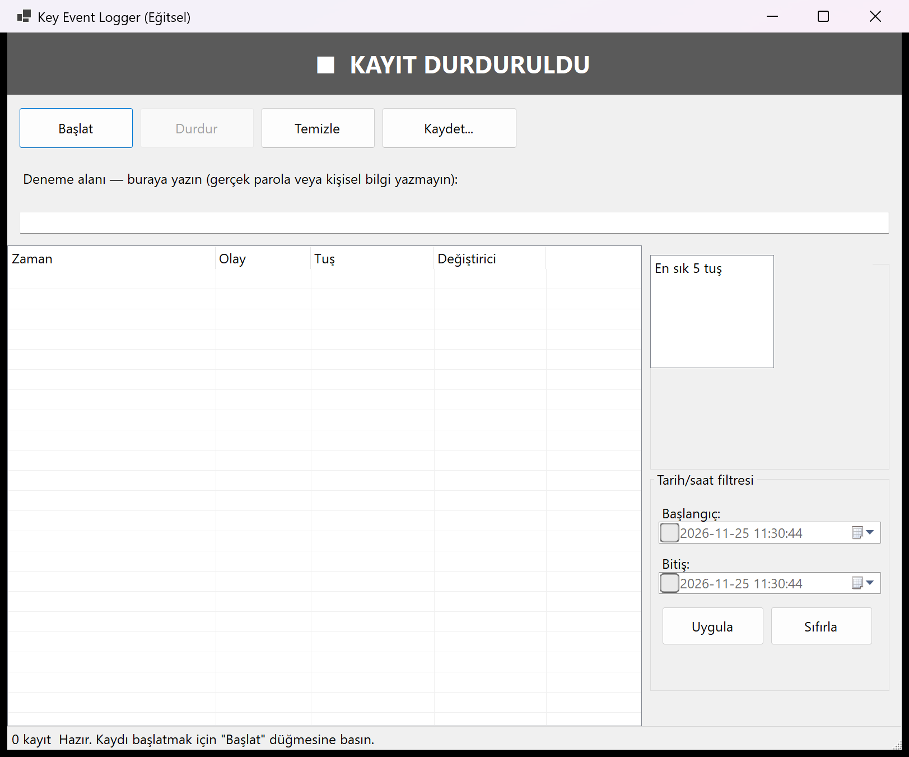
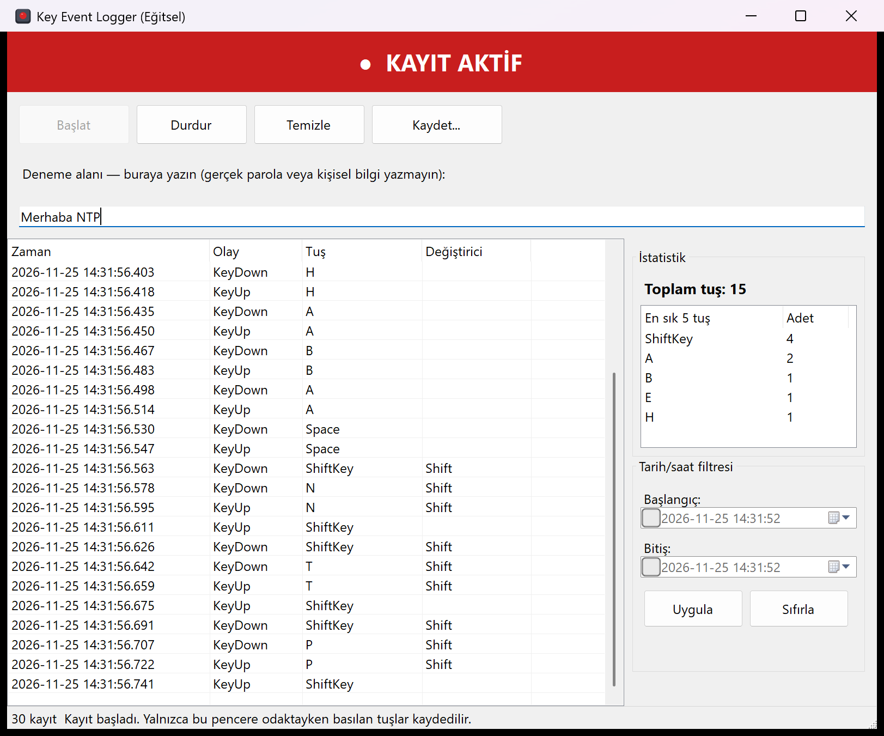
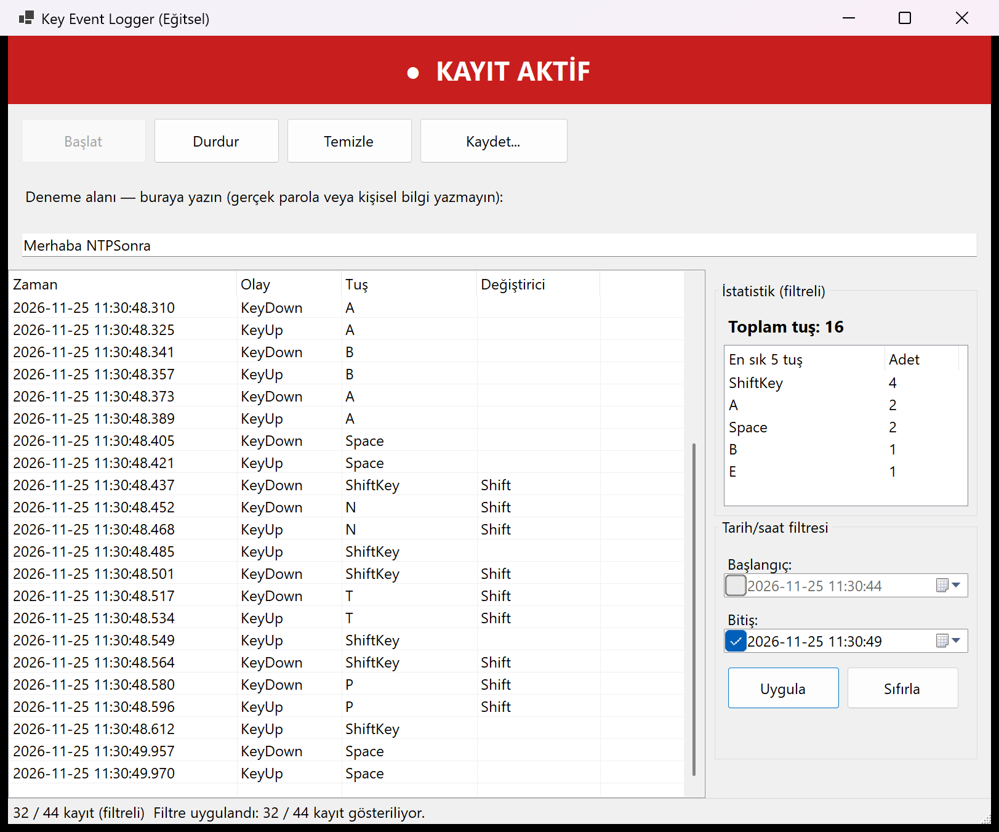

# Key Event Logger (Eğitsel Keylogger)

Windows Forms ile yazılmış, **eğitim amaçlı** bir klavye olayı kaydedicisidir. Uygulama, klavye olaylarının
(`KeyDown`, `KeyUp`) nasıl yakalandığını ve uygulama içinde nasıl işlendiğini gösterir: tuşlar zaman damgasıyla
listelenir, istatistiği çıkarılır, tarih/saat aralığına göre süzülür ve istenirse yerel bir `.txt` dosyasına kaydedilir.

> **Bu bir gerçek sistem keylogger'ı değildir.** Uygulama yalnızca **kendi penceresi odaktayken** basılan tuşları görür.
> Ayrıntılar için [Kapsam ve Güvenlik Sınırı](#kapsam-ve-güvenlik-sınırı) bölümüne bakın.

## Ekran Görüntüleri

**Başlangıç durumu** — kayıt kapalı, liste boş:



**Kayıt aktif** — tuşlar zaman damgasıyla listelenir, sağda toplam tuş sayısı ve en sık kullanılan 5 tuş görünür:



**Tarih/saat filtresi** — "Bitiş" zamanı işaretlenip uygulandığında yalnızca aralığa uyan kayıtlar (32 / 44) görünür,
istatistik de yalnızca görünen kayıtlar için hesaplanır:



## Temel Özellikler

- **Başlat / Durdur:** Kayıt yalnızca kullanıcı "Başlat"a bastığında başlar. Uygulama her zaman *durdurulmuş* durumda açılır.
- **Açık kayıt göstergesi:** Üstteki şerit, kayıt aktifken kırmızı **● KAYIT AKTİF**, değilken gri **■ KAYIT DURDURULDU**
  yazar (hem renk hem metin değişir). Düğmeler duruma göre etkinleşir/pasifleşir.
- **Olay listesi:** `Zaman | Olay | Tuş | Değiştirici` sütunlarıyla `KeyDown` ve `KeyUp` olayları; Ctrl/Alt/Shift
  değiştiricileri ayrı sütunda gösterilir.
- **Temizle:** Onay isteyerek (varsayılan cevap *Hayır*) ekrandaki kayıtları siler.
- **Kaydet:** `SaveFileDialog` ile seçilen `.txt` dosyasına, her satırda bir olay olacak şekilde UTF-8 yazar.
- **İstatistik:** Toplam tuş sayısı ve en sık kullanılan 5 tuş.
- **Tarih/saat filtresi:** Başlangıç ve/veya bitiş zamanı (onay kutulu, açık uçlu). Filtre aktifken sayaç
  `görünen / toplam kayıt (filtreli)` biçiminde gösterilir; istatistik ve "Kaydet" yalnızca görünen kayıtlarla çalışır.
- **Hata yönetimi:** Geçersiz aralık, boş liste, yazılamayan dosya (yetki, kilitli dosya, olmayan klasör) için
  kullanıcıya anlaşılır mesajlar gösterilir.

Kaydedilen dosyanın biçimi:

```text
2026-11-25 11:30:48.278 | KeyDown | H | -
2026-11-25 11:30:48.294 | KeyUp | H | -
2026-11-25 11:30:48.437 | KeyDown | ShiftKey | Shift
2026-11-25 11:30:48.452 | KeyDown | N | Shift
```

## Kullanılan Teknolojiler

| Alan | Teknoloji |
|------|-----------|
| Dil / platform | C# 14, **.NET 10** (SDK 10.0.x, `global.json` ile sabitlenmiştir) |
| Arayüz | Windows Forms (`net10.0-windows`) |
| Testler | xUnit |

NuGet paketleri (yalnızca test projesinde):

- `xunit` 2.9.3
- `xunit.runner.visualstudio` 3.1.4
- `Microsoft.NET.Test.Sdk` 17.14.1
- `coverlet.collector` 6.0.4

Çalışan uygulama (`Core` ve `App` projeleri) **hiçbir NuGet paketi kullanmaz**.

## Kurulum ve Çalıştırma

**Gereksinimler:** Windows 10/11 ve [.NET 10 SDK](https://dotnet.microsoft.com/download).

```powershell
git clone https://github.com/grizzy8/KeyEventLogger.git
cd KeyEventLogger

# Uygulamayı çalıştır
dotnet run --project src/KeyEventLogger.App

# Birim testlerini çalıştır
dotnet test
```

**Visual Studio ile:** `KeyEventLogger.sln` dosyasını açın, başlangıç projesi olarak `KeyEventLogger.App`'i seçin ve
<kbd>F5</kbd>'e basın.

**Kullanım:** "Başlat"a basın, pencere odaktayken (örneğin "Deneme alanı"na) bir şeyler yazın, kayıtları listede görün.
İsterseniz "Kaydet..." ile dosyaya yazın.

## Proje Yapısı

```text
KeyEventLogger.sln
├── src/
│   ├── KeyEventLogger.Core/      Arayüzden bağımsız mantık (net10.0)
│   │   ├── Models/               KeyLogEntry, KeyEventType, KeyCount, TimeRange
│   │   └── Services/             KeyLogSession, CapturePolicy, PressedKeyTracker,
│   │                             KeyStatistics, LogFilter, ILogWriter, TextFileLogWriter
│   └── KeyEventLogger.App/       Windows Forms arayüzü (net10.0-windows)
│       └── MainForm*, KeyMapper, KeyInputGuard, app.ico (uygulama ikonu)
└── tests/
    └── KeyEventLogger.Tests/     xUnit birim testleri
```

İş mantığı (`Core`) WinForms'a bağımlı değildir; tuş adları metin olarak tutulur. Bu sayede kayıt oturumu,
istatistik, filtre ve dosya yazma kuralları arayüz olmadan birim testlerle doğrulanabilir. `App` projesi yalnızca
formu ve WinForms tuş verisinin dönüştürülmesini içerir.

## Kapsam ve Güvenlik Sınırı

Bu proje bir ders ödevidir ve **gerçek bir sistem keylogger'ı değildir**. Aşağıdaki sınırlar kodda uygulanmıştır:

| Yasak davranış | Uygulamadaki karşılığı |
|----------------|------------------------|
| Global keyboard hook | Yalnızca formun kendi `KeyDown`/`KeyUp` olayları kullanılır (`KeyPreview`). Native API / P/Invoke yoktur. |
| Başka pencerelerdeki tuşlar | Pencere odakta değilse hiçbir şey kaydedilmez (`CapturePolicy`). |
| Gizli / arka plan çalışma | Pencere her zaman görünürdür, görev çubuğunda yer alır. Tepsi simgesi, servis veya arka plan işlemi yoktur. |
| Başlangıçta otomatik çalışma | Registry, Başlangıç klasörü veya zamanlanmış görev kullanılmaz. Uygulama her açılışta *durdurulmuş* başlar. |
| Parola / kimlik bilgisi yakalama | Parola alanlarındaki (`UseSystemPasswordChar` / `PasswordChar`) tuşlar kaydedilmez. Formda parola alanı yoktur. |
| Başka uygulamalardan veri toplama | Pano, ekran veya diğer süreçler okunmaz. |
| Ağ üzerinden gönderme | Ağ erişimi yoktur. Kayıtlar yalnızca bellekte tutulur ve kullanıcı "Kaydet..." diyerek seçtiği yerel dosyaya yazılır. |

Kayıtlar uygulama kapanınca bellekten silinir; otomatik veya gizli bir log dosyası oluşturulmaz.

## Bilinen Sınırlamalar / Geliştirme Notları

- Yalnızca **Windows** üzerinde çalışır (Windows Forms).
- Sistem kısayolları (<kbd>Alt</kbd>+<kbd>Tab</kbd>, <kbd>Win</kbd> tuşu vb.) işletim sistemi tarafından
  yakalandığı için forma ulaşmaz.
- Tuşlar, üretilen karakter olarak değil **sanal tuş adı** olarak kaydedilir (örneğin `OemPeriod`, `ShiftKey`).
  Türkçe klavyede <kbd>AltGr</kbd>, Windows'ta <kbd>Ctrl</kbd>+<kbd>Alt</kbd> olarak göründüğü için bazı karakterler
  `Ctrl+Alt` değiştiricisiyle listelenebilir.
- Değiştirici tuşların kendisi de (örneğin `ShiftKey`) bir tuş basışı olarak sayılır ve istatistikte görünebilir.
- Bir tuş basılı tutulduğunda yalnızca ilk `KeyDown` kaydedilir (otomatik tekrarlar elenir).
- Zaman filtresi **saniye hassasiyetlidir**: bitiş zamanı olarak seçilen saniyenin tamamı aralığa dahildir.
- Tüm kayıtlar bellekte tutulur ve `ListView` sanal mod kullanmaz; çok uzun oturumlarda (yüz binlerce olay) arayüz
  yavaşlayabilir.
- Olası geliştirmeler: `KeyPress` ile üretilen karakterin de gösterilmesi, CSV dışa aktarma, otomatik tekrar eden
  tuşların isteğe bağlı gösterimi.
